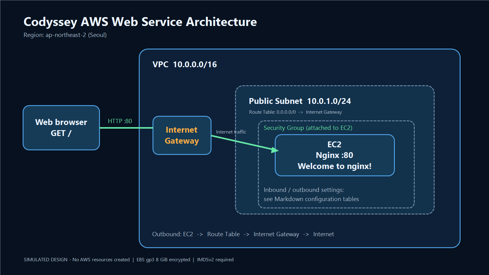
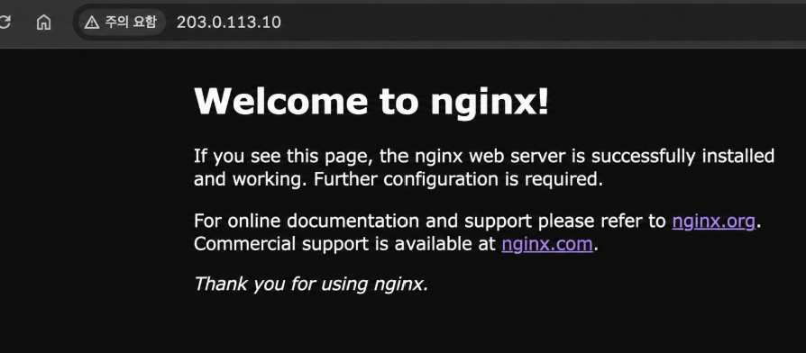

# AWS 웹 서비스 인프라 구축

VPC로 격리된 네트워크를 설계하고 EC2에 Nginx를 배포하는 과정을 정리한다. 네트워크 구성, 최소 권한, 외부 접속 검증, 장애 분석, 리소스 정리까지 하나의 시나리오로 설명한다.

## 1. 구성

| 항목 | 설계값 |
|---|---|
| 리전 / 가용 영역 | 서울 `ap-northeast-2` / `ap-northeast-2a` |
| VPC | `codyssey-web-vpc` · `10.0.0.0/16` |
| Public Subnet | `codyssey-public-subnet` · `10.0.1.0/24` |
| Internet Gateway | `codyssey-web-igw` · VPC에 연결 |
| Route Table | `10.0.0.0/16 → local`, `0.0.0.0/0 → IGW` · Public Subnet 연결 |
| EC2 | `codyssey-web-ec2` · `t3.micro` 1대 · Amazon Linux 2023 |
| Security Group | `codyssey-web-sg` · HTTP 80 전체 허용 / SSH 22 관리자 IP만 허용 |

## 2. 아키텍처

외부 HTTP 요청은 IGW를 거쳐 EC2의 네트워크 인터페이스에 도달하고, 연결된 보안 그룹의 TCP 80 규칙을 통과하면 Nginx가 응답한다. 서브넷의 라우팅 테이블은 인터넷 목적지 경로를 지정한다.

## 3. 보안 그룹 및 접근 설정

| 방향 | 유형 | 프로토콜 | 포트 | 소스 / 목적지 | 용도 |
|---|---|---|---|---|---|
| 인바운드 | HTTP | TCP | 80 | `0.0.0.0/0` | 외부 브라우저 웹 접속 |
| 인바운드 | SSH | TCP | 22 | `198.51.100.25/32` | 관리자 PC만 접속 |
| 아웃바운드 | HTTP | TCP | 80 | `0.0.0.0/0` | HTTP 저장소 접근 |
| 아웃바운드 | HTTPS | TCP | 443 | `0.0.0.0/0` | HTTPS 저장소·외부 연결 확인 |

## 4. 외부 접속 검증 예시

| 구분 | 내용 |
|---|---|
| 선택 방식 | **브라우저에서 퍼블릭 IP 접속** |
| 접속 정보 | `http://203.0.113.10/` |
| 결과 | `Welcome to nginx!` 환영 페이지 표시 |

## 5. 문서 및 결과물

| 결과물 | 위치 |
|---|---|
| 아키텍처 다이어그램 | [PNG](docs/images/architecture.png) · [해설](docs/architecture.md)
| 외부 접속 예시 | [브라우저 예시 PNG](docs/images/connect_ex.png)
| 보안 그룹과 IAM | [docs/security-and-iam.md](docs/security-and-iam.md)
| 트러블슈팅 보고서 | [docs/troubleshooting.md](docs/troubleshooting.md)
